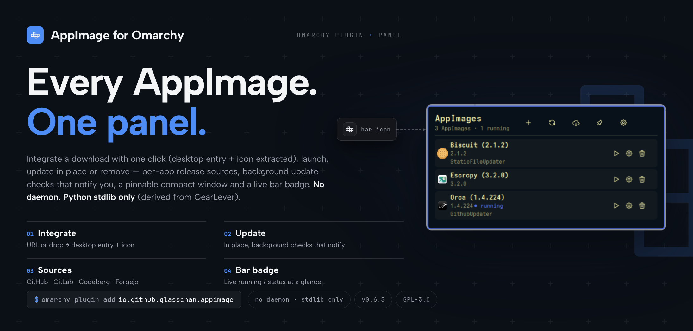

# AppImage for Omarchy



[](https://github.com/glasschan/appimage-for-omarchy/actions/workflows/ci.yml)

Manage AppImages from the Omarchy bar: integrate new ones into your app
menu — from a local file (through a Browse dialog, a pasted path, or a
drag-and-drop) or straight from a release URL — see what is
installed (and running), launch, update, and remove them — all in a
native Quickshell panel. No daemon, no extra runtime: the
panel is plain QML and the backend is a Python-stdlib CLI that runs only
when an action needs it.

Backend logic is derived from
[GearLever](https://github.com/mijorus/gearlever) (GPL-3.0, mijorus), so
this plugin is licensed under **GPL-3.0** as well — see [LICENSE](LICENSE).
UI icons are from [tabler-icons](https://github.com/tabler/tabler-icons)
(MIT, Paweł Kuna) — see [icons/LICENSE-TABLER.md](icons/LICENSE-TABLER.md).

The panel header is a row of icon-only buttons with tooltips —
Integrate, Refresh, Check updates, Pin, Settings. Pin toggles the panel
between the full-screen overlay and a compact floating window
(session-only, never persisted). When updates are pending, the bar
badge turns urgent and counts them.

Errors are never silent: a hung backend or invalid JSON surfaces as a
dismissible banner in the panel, and a missing `python3` swaps the panel
body for an authorized-install card (see *Install → Python dependency*).
A launch that never comes up — checked against the process list after a
short grace, since a spawn either starts or dies within moments — raises
its own banner; when the backend's best-effort probe reports the fuse2
runtime library (`libfuse.so.2`) missing, that banner adds one text-only
line naming it as the most common cause. No command, no button: the hint
names the library and nothing more, and a `present` or `unknown` probe
never adds it.
Status messages auto-clear after 5 s; errors stay until dismissed. A
backend call that overruns its watchdog reports a timeout — never a
misleading "python3 missing" hint.

## Requirements

- `python3` (the backend is standard-library only) — present on a normal
  Omarchy install. If it is missing, the panel offers a one-click,
  terminal-authorized install (see below); nothing is ever installed
  without that explicit okay.
- `notify-send` (libnotify) for the background-check desktop notification —
  present on Omarchy; a missing binary just means no notification, never
  a failure.
- `fuse2` (the `libfuse.so.2` shared library) to *launch* type-2
  AppImages — some systems ship without it. Managing AppImages never
  needs it: the backend reads metadata without executing anything. The
  installed listing carries a best-effort probe (`present` / `missing` /
  `unknown`); a launch failure while the probe says `missing` names the
  library in the banner as the most common cause — a text-only hint,
  never an install action.
- Nothing else is required: `unsquashfs`/`bsdtar` (optional fallbacks for
  exotic squashfs compressions), `zstd` (zstd AppImages on Python < 3.14),
  `ps` and `update-desktop-database` are best-effort and their absence is
  never an error (see [backend/CONTRACT.md](backend/CONTRACT.md)). The
  AppImage is never executed to read its metadata.
- AppImage detection accepts the type-1/type-2 magic bytes; magicless
  type-2 builds (modern images that omit the optional `AI\x02` magic) are
  still detected via the ELF header plus a squashfs magic at the
  section-header-table offset.

Security posture (v0.4.2, from a marketplace security review): all
backend egress is https-only with an SSRF guard (public addresses only,
DNS-rebinding-safe dialing, validated redirects), hard byte caps and
absolute whole-operation deadlines on responses; downloaded updates are
installed only after verification against a mandatory cryptographic
digest (GitHub sha256 asset digest, zsync SHA-1 control-file line) —
sources that expose no digest refuse to *update*; an AppImage integrated
directly from a URL is the one exception (reduced assurance: AppImage
magic bytes + advertised size); the trust boundaries
cannot be disabled from the environment; installs are atomic (a planted
symlink at a destination is replaced, not written through), uninstalls
only remove paths provably bound to the app, extraction is quota-limited
and symlink-contained, and subprocess output is size-capped on the
producer side. Details in
[backend/CONTRACT.md](backend/CONTRACT.md) ("Security model").

## Install

Everything happens through Omarchy itself — the plugin ships no install
scripts and has no manual setup steps:

```sh
omarchy plugin add https://github.com/glasschan/appimage-for-omarchy --enable
```

Update and removal go through the shell too:

```sh
omarchy plugin update io.github.glasschan.appimage   # then: omarchy restart shell
omarchy plugin remove io.github.glasschan.appimage
```

### Python dependency (authorized in the panel)

The backend needs `python3` — standard library only, no pip packages. On
the rare Omarchy install without it, the panel detects that, and its body
is replaced by an explanation plus an **Install Python** button. Pressing
the button is the authorization: it opens a visible floating Omarchy
terminal that shows the Omarchy logo and then runs the exact command
(`/usr/bin/omarchy pkg add python`) — the command line itself is not
echoed, but the install (and any `sudo` prompt) is on screen, and you
can cancel it like any terminal install.
The command is a fixed string (your `XDG_RUNTIME_DIR` is never spliced
into it), and the install is refused up front unless that directory is an
absolute, owner-only (0700) directory owned by you. The panel polls the
outcome and picks up automatically: success loads your AppImages, a
cancel or failure says so.

For development, validate and load straight from a checkout:

```sh
omarchy plugin validate "$PWD"
omarchy plugin enable io.github.glasschan.appimage
omarchy restart shell
```

Then click the bar button, or:

```sh
omarchy-shell shell summon io.github.glasschan.appimage '{}'
```

### Development checks

```sh
bash scripts/ci/security-gates.sh      # backend invariant greps (CI + release)
bash scripts/ci/qml-property-gate.sh    # local QML components expose every property we assign
bash scripts/ci/qml-compile-check.sh    # compile every QML entry point (needs quickshell)
```

The last two guard a silent failure mode: assigning a QML property a type
does not declare is a **compile error**, so the whole panel fails to load —
and the shell swallows the load error, leaving a bar button that does
nothing when pressed. `qml-compile-check.sh` needs Quickshell (it skips
without it); `qml-property-gate.sh` is dependency-free and runs in CI.

## Backend CLI

The QML layer talks to `backend/main.py` over a stable JSON contract
(see [backend/CONTRACT.md](backend/CONTRACT.md)):

```sh
python3 backend/main.py --list-installed --json
python3 backend/main.py --integrate /path/to/App.AppImage --yes --json
python3 backend/main.py --integrate https://github.com/<owner>/<repo>/releases/download/<tag>/<file> --yes --json
python3 backend/main.py --preview-integrate /path/to/App.AppImage --json
python3 backend/main.py --pick-file --json
python3 backend/main.py --remove <desktop-id> --yes --json
python3 backend/main.py --list-updates --json
python3 backend/main.py --update <desktop-id> --yes --json
python3 backend/main.py --update <desktop-id> --yes --json --async
python3 backend/main.py --set-update-source <desktop-id> --manager StaticFileUpdater url=https://example.com/app.AppImage --json
python3 backend/main.py --get-update-source <desktop-id> --json
python3 backend/main.py --list-update-managers --json
python3 backend/main.py --fetch-updates --json
python3 backend/main.py --settings --json
python3 backend/main.py --set-setting update_check_interval_minutes=120 --json
```

With `--json`, stdout is exactly one JSON document (logging goes to
stderr); `--json` requires `--yes` for integrate/remove/update.
`--get-update-source` reads a configured source back — the configured
manager + config, or `no-source` — which is what the panel's source
editor pre-fills from when it opens.

### Integrate picker

The Integrate card takes a pasted path or release URL, quick-picks from
`~/Downloads`, or a **Browse…** button. Browse runs `--pick-file`: the
backend opens a native single-file, AppImage-filtered dialog — the
desktop portal first, `zenity` as the fallback — orchestrating it as an
isolated child process under one absolute 600 s whole-operation
deadline, so a crashed or hung dialog can never take the panel down.
A picked file fills the panel's path field ready to integrate; the fill
itself integrates nothing (and dismisses any preview of a different
path) — the next Enter or **Integrate** press runs the preview flow
below. A cancel is a quiet notice; a missing file chooser reports itself
and the paste-a-path flow keeps working exactly as before. Timeout and
dialog failures surface as dismissible banners. The result documents
(`picked` / `cancelled` / `unavailable`, typed `timeout` /
`backend-failed` / `not-local` errors) are mapped defensively and
pinned by `tests-js/parse-harness.mjs`.

### Drop to integrate

Dragging an AppImage file from a file manager onto the bar icon or onto
the panel window opens the Integrate picker with that file already
filled in and its preview card showing — the same confirm-before-install
flow as every other route, so a drop never installs anything by itself.
Only local AppImage files are accepted (a dragged web address is not a
drop here); a selection without an AppImage reports itself as a status,
and a multi-file drop uses the first AppImage and says how many others
were ignored. Hovering a drag over either surface highlights it — the
panel shows a veil with a "Drop to integrate" chip, the bar icon tints
with the theme accent.

### Integrate: preview before install

The panel's Integrate picker is not a one-press commit. Every route into
it — a typed or pasted path/URL (Enter), the picker's **Integrate**
button, a Downloads quick-pick, or a dropped file — first shows a
**preview card** built
by the offline `--preview-integrate` verb: the app name and version read
from the file itself (URL sources show "unknown until download" — the
preview fetches nothing), the destination path, and how the artifact
will be verified at integrate time. A source that publishes no digest
says so up front with a prominent **will install with reduced
assurance** line — before anything is downloaded; an already-integrated
file shows a notice that confirming changes nothing, and a same-app
version conflict says integrate keeps both.

**Confirm** (Enter or the button) then runs the real integrate command —
which re-classifies and re-verifies from scratch, so a file that changed
between preview and confirm is still caught. **Esc** (or Cancel) goes
back to the picker with zero side effects. When the preview itself
fails (bad path, non-AppImage file), the panel shows the error banner
and the picker stays usable.

The preview is advisory: it makes no network requests, never executes
the AppImage, and installs nothing on its own.

### Install from a URL

`--integrate` also takes an https URL — the panel's Integrate field takes
the same value, so you can paste a link instead of a path. The URL is
classified (first match wins) and routed to a download/verify path:

- **GitHub release download URL** → the asset's `sha256` digest from the
  GitHub API is required and verified before install;
- any URL ending in **`.zsync`** → the control file's `SHA-1` line is
  verified when present;
- **GitLab / Codeberg / Forgejo release URL** → the release is looked up
  through the host's API (falling back to a plain static install if that
  lookup fails);
- anything else → the URL is downloaded and installed as a static source.

When the source publishes no digest, the artifact is accepted with reduced
assurance — it must pass the AppImage magic-byte check and match the
advertised size (release-API size or Content-Length) — and a warning is
logged. `--update` never relaxes in this way.

After a successful install the matching update source is auto-configured
from the URL (GitHub / static / GitLab / Codeberg / Forgejo), unless you
already chose one — a manual `--set-update-source` always wins.

### Update sources

Every app's update source is resolved locally, before any network access:
a custom source from `apps.ini` wins, otherwise the AppImage's embedded
`.upd_info` ELF section is routed (`gh-releases-zsync|…` → GitHub,
`zsync|<url>` → static file; anything else → no source). The five managers
and the `key=value` config keys each accepts:

| Manager | Source | Config keys |
|---|---|---|
| `StaticFileUpdater` | Static URL | `url` |
| `GithubUpdater` | GitHub releases | `repo`, `repo_filename`, `allow_prereleases` |
| `GitlabUpdater` | GitLab releases | `repo_url`, `repo_filename` |
| `CodebergUpdater` | Codeberg releases | `repo`, `repo_filename`, `allow_prereleases` |
| `ForgejoUpdater` | Forgejo releases | `repo_url`, `repo_filename`, `allow_prereleases` |

The panel's source editors pre-fill from the stored config when opened
(read back via `--get-update-source`). `repo_filename` is a glob matched
against the release asset's full name — it must match the asset name
exactly, including dots vs spaces (e.g. `Simplexity.AI-*.AppImage`),
not just a substring; when several assets match, the local architecture
is preferred.

Per-app sources live in
`$XDG_CONFIG_HOME/io.github.glasschan.appimage/apps.ini` (GearLever-
compatible INI); global settings in `…/settings.json` —
`update_check_enabled`, `update_check_interval_minutes` (minimum 15) and
`update_check_delay_minutes`, all writable via `--set-setting`.

### Updating

**Check updates** sweeps every configured source and marks each row with
a pending release; the row's Update button starts the update as a
**detached background job** (the `--update --async` form above) — the
panel stays responsive, several apps
can update at once, and a running job never blocks anything else. While
a job runs, its row shows live progress (percent, plus a byte pair when
the source declares a real download size). A job's state lives in a
small document on disk (`$XDG_STATE_HOME/io.github.glasschan.appimage/
jobs/`), so closing the panel — or restarting the shell mid-download —
loses nothing: reopening shows the job still running, and a job whose
updater died (or whose heartbeat went quiet) shows an interrupted notice
with the Update button ready to retry. Outcomes show in the panel as
they finish, and the background checker announces new updates and
outcomes with desktop notifications. A janitor sweep expires settled job
documents (and their logs) after 24 h. While a row's job is still
running its Remove button stays disabled — the job installs over that
AppImage, so removing it mid-flight would leave the new release with no
target (the armed "Remove?" confirm honours the same block).

## Plugin layout

```
manifest.json     Omarchy plugin manifest (bar-widget + panel + service)
BarWidget.qml     Bar entry: icon + count badge, summons the panel
Panel.qml         Main panel (list, picker, update rows, settings card, states, Escape via PanelKeyCatcher)
SafeTextField.qml Clipboard-safe text field (permanently readOnly + key-driven editing + bounded fail-closed wl-paste) — every text entry goes through it; mirrors qs.Ui.TextField's `foreground`/`accent` theming
Service.qml       Background update checker (scheduled --fetch-updates sweeps)
ThemeIcon.qml     Theme-colored tabler icon (runtime currentColor tint)
lib/Model.js      Shared state store (items cache, counts, busy flags, JSON mapping)
lib/Backend.js    Process wrapper for the backend CLI (watchdog, tolerant JSON parse)
lib/JobDocs.js    Update-job document reader (parse, classify, adopt — node-tested decision table)
icons/            Bundled tabler SVGs (cube-unfolded, plus, refresh, trash, player-play, settings, arrow-up, cloud-download, pin; MIT) + LICENSE-TABLER.md
backend/          Python stdlib CLI (derived from GearLever)
```

## Releases / versioning

The version lives in `manifest.json`. To cut a release: bump that
version, commit, then push a tag `v<version>` (bump first, tag second).
Pushing the tag triggers [.github/workflows/release.yml](.github/workflows/release.yml),
which verifies the tag matches the manifest version, runs the same tests
as CI, packages the runtime file set into
`io.github.glasschan.appimage-<version>.zip` (it unpacks into a folder
named after the plugin id), and publishes a GitHub Release with
auto-generated notes. Running the workflow manually (`workflow_dispatch`)
is a dry run: the zip is uploaded as a build artifact and nothing is
published.

### 0.8.0

- Updates run as **detached background jobs**: the row's Update button
  spawns `--update --async`, the panel stays responsive, several apps
  update in parallel, and a job survives closing the panel or restarting
  the shell — reopening shows live progress, an interrupted notice with
  a working retry, or the finished outcome. Job state is a small
  per-app document under `$XDG_STATE_HOME/io.github.glasschan.appimage/jobs/`;
  a janitor sweep expires settled documents (and their logs) after 24 h
  and removes orphaned partial downloads.
- The background checker announces job outcomes (updated / failed /
  interrupted) with desktop notifications.
- The row's Remove button is blocked while that row's update job is
  still running (the job installs over the AppImage it would delete).
- New CLI surface: `--update <target> --async` (job-started document),
  documented in `backend/CONTRACT.md` together with the job-document
  schema and the job liveness rule.

### 0.7.0

- Exec arguments are forwarded on launch: the backend reports each app's
  `exec_arguments` (e.g. `--no-sandbox %U`) and the panel passes the real
  flags to the AppImage, dropping the desktop field codes it has nothing
  to fill.
- The panel closes after launching an app, unless it is pinned — a pinned
  panel is a compact floating window that is meant to stay open.
- Stale integration records (a recorded app whose `.desktop` file is
  gone) are reported by `--list-installed` and can be removed by their
  desktop id; nothing is deleted automatically.
